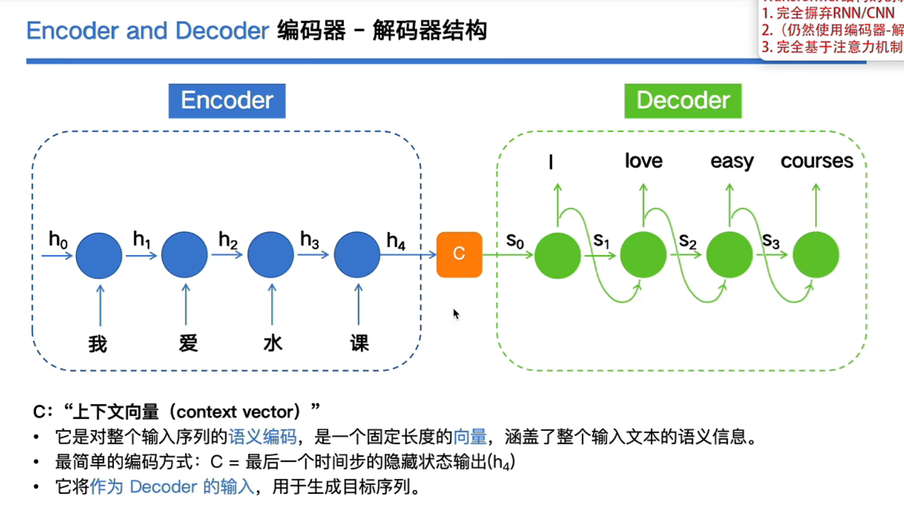
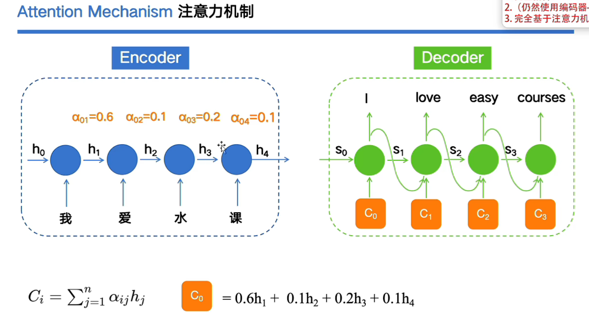
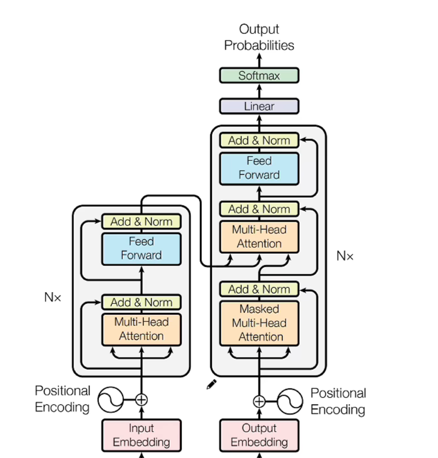
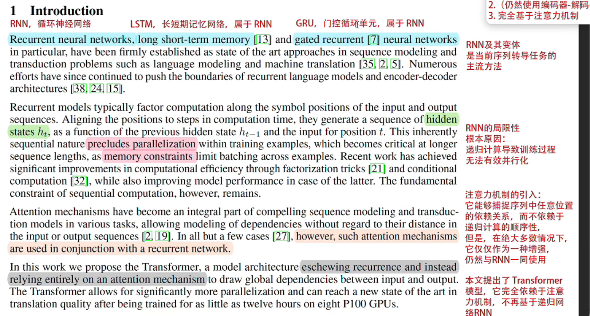
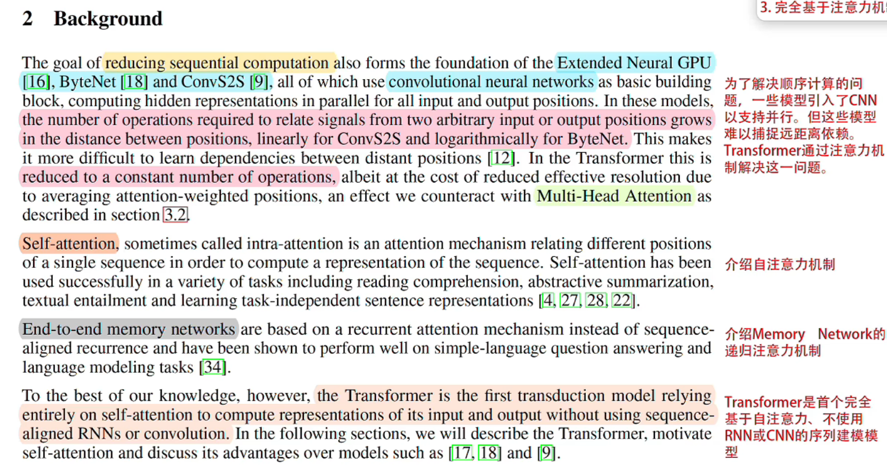
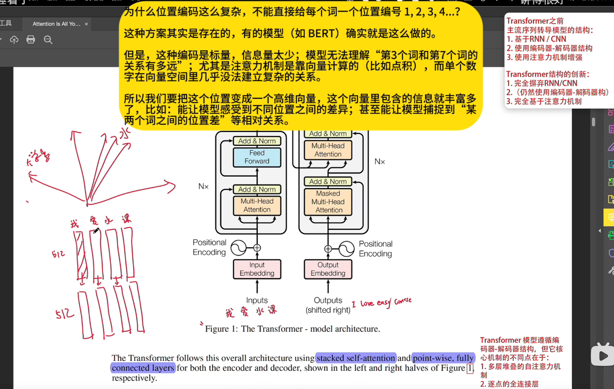
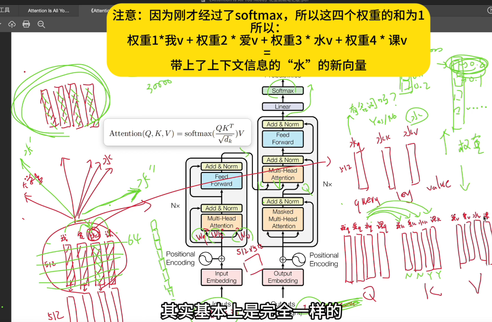
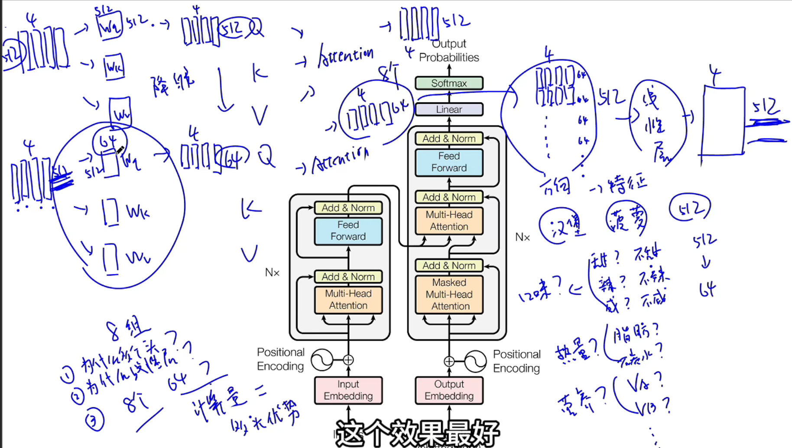

# 前面是一些笔记









# LayerNorm 

LayerNorm（层归一化）：**对每个词位置的向量，单独做一次归一化**，把数值拉到均值接近 0、方差接近 1 的分布，再用两个可学习参数调整幅度和偏移。
归一化的方向：在**特征维度 D** 上做
```python
self.layer=nn.LayerNorm(fea)


# forward 里
out = self.norm(x)
```
`ormalized_shape` 会和张量**尾部对齐**，只能选取**末尾连续维度**，不能随便挑中间某一维
ln = nn.LayerNorm([L, D])
`nn.LayerNorm` 是一个**Module，里面要提前创建 weight (γ)、bias (β) 这两个可学习参数**，参数的形状就由传入的 `normalized_shape` 决定

> 和函数不一样，函数一般是传dim=-1等表示**函数里指定在哪个维度做运算**，这是一层网络


# 掩码
```python
pad_mask = (sen_tensor == padding_num).unsqueeze(1)
point = point.masked_fill(pad_mask, float("-inf"))
```

## 一
```
pad_mask = (sen_tensor == padding_num).unsqueeze(1)
```

1. `sen_tensor == padding_num`

`sen_tensor` 是 ID 矩阵，形状 `[B, L]`（本题 `[8, 5]`）；`padding_num` 是 `<PAD>` 的 ID，值为 0。

`==` 是**逐元素比较**：每个位置的 ID 是否等于 0，得到一个布尔张量：

- 等于 0（是 PAD）→ `True`；
- 不等于 0（真实词）→ `False`。

```
sen_tensor：          比较结果（布尔）：
[2, 3, 4, 5, 0]  →  [F, F, F, F, T]
[2, 3, 6, 0, 0]  →  [F, F, F, T, T]
```

此时形状还是 `[B, L]`。

2. `.unsqueeze(1)`

`unsqueeze(1)` 在**第 1 维（中间）插入一个大小为 1 的新维度**：

```
[B, L]  →  [B, 1, L]
```

## 二
```
point = point.masked_fill(pad_mask, float("-inf"))
```

接收两个参数：
- 第一个：掩码张量，布尔值；
- 第二个：填充值。
**掩码为 `True` 的位置，用填充值替换；为 `False` 的位置，保持原值不变。**

# 写的过程中遇到的一些问题
1. 三维张量误用 `.T` 转置
- `Q1 @ K1.T` 维度对不上
- 忘记了三维 `.T` 会反转全部维度，不是只交换最后两维
- 改用 `K1.transpose(-1, -2)`

2. 我还浪费时间自己写了一个embedding
```python
embedding=torch.randn(len(vocab),fea)

result_1=torch.zeros(sen_tensor.size(0),max_len,fea)
for i in range(sen_tensor.size()[0]):
    for j in range(sen_tensor.size()[1]):
        if sen_tensor[i][j]!=padding_num:
            num=sen_tensor[i][j]
            result_1[i][j]=embedding[num]
print(result_1)
        对应的向量的初始位置也是要训练的
```
- 写完我还觉得挺对，后面突然想起来这玩意要更新的啊...我写一个随机初始化干嘛

3. layernorm
- 一开始没仔细看要传什么我写成了nn.LayerNorm(dim=-1)
- 后来想可能是一下搞混了函数传的要处理的维度比如说sum，但是这里要传特征数实际上需要的是特征数才能创建里面需要的矩阵啊！

4. 整数张量叫longtensor，虽然整数一般用int

5. id用作变量名了
- 我写的时候把一个变量叫做id结果变色了，原来这是一个函数呀